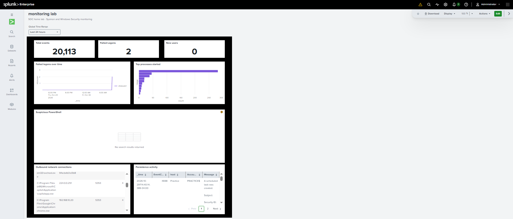
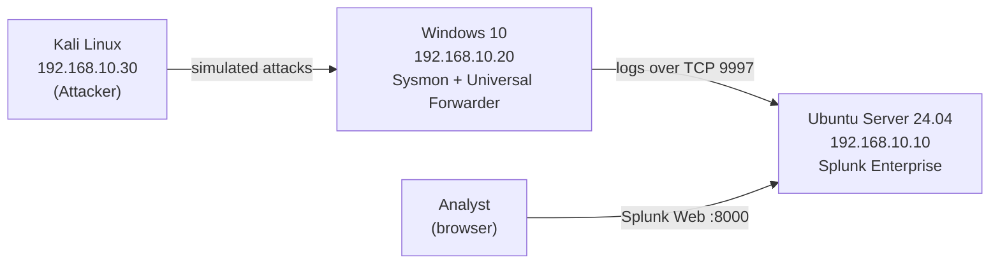
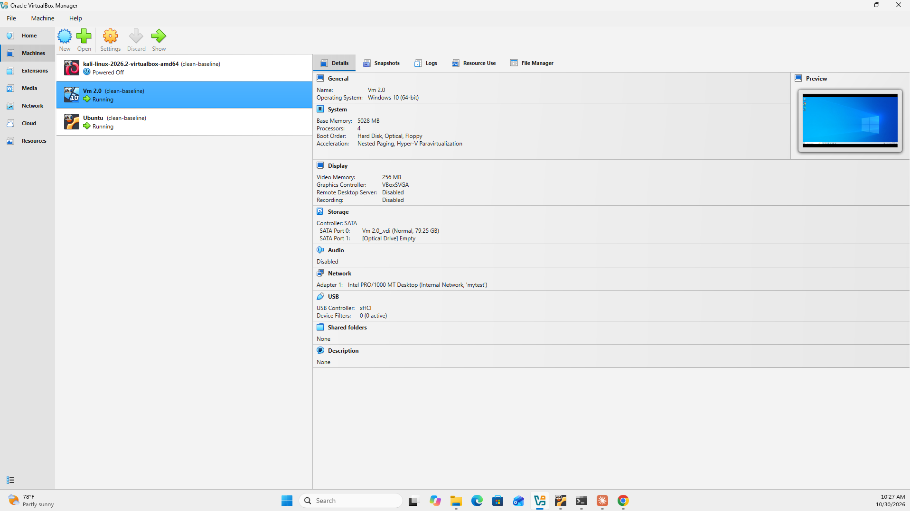
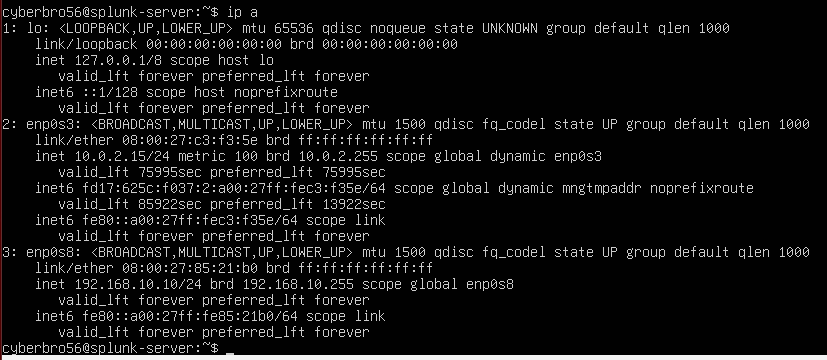
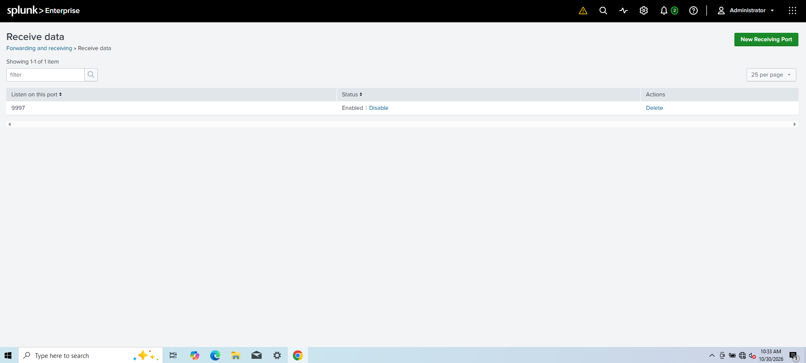
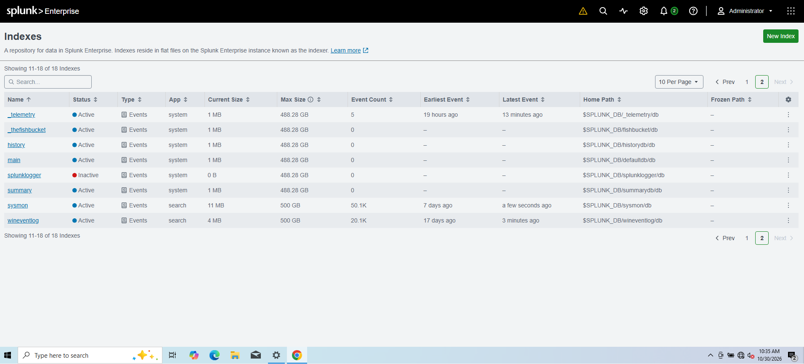
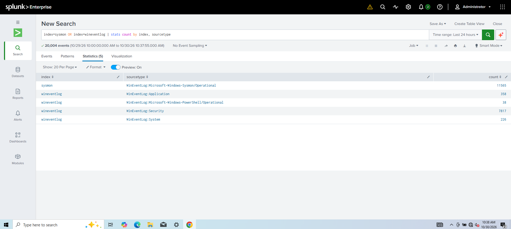

# SOC Home Lab — Splunk + Sysmon Detection Engineering

A virtualized Security Operations Center (SOC) lab built to practice log collection, threat detection, and incident investigation. Windows endpoint telemetry (Sysmon, Security, PowerShell) is shipped to a central Splunk server, where custom detections are written, mapped to **MITRE ATT&CK**, and turned into scheduled alerts.



---

## Architecture



All VMs sit on an isolated VirtualBox **Internal Network** (`192.168.10.0/24`). The Splunk server has a second NAT adapter for updates only.

| Host | OS | IP | Role | Resources |
|---|---|---|---|---|
| splunk-server | Ubuntu Server 24.04 LTS | 192.168.10.10 | SIEM (Splunk Enterprise 10.6) | 4 vCPU / 4 GB |
| Practice | Windows 10 | 192.168.10.20 | Monitored endpoint | 4 vCPU / 5 GB |
| kali | Kali Linux | 192.168.10.30 | Attack simulation | 2 vCPU / 2 GB |

---

## What I Built

- **Headless Splunk server** on Ubuntu Server, managed over SSH, with static IP via netplan and receiving enabled on TCP 9997.
- **Splunk Universal Forwarder** on the Windows endpoint, configured through [`inputs.conf`](configs/inputs.conf) to ship:
  - Sysmon Operational log → `sysmon` index
  - Security, System, Application, PowerShell Operational logs → `wineventlog` index
- **Sysmon** for process creation, network connections, DNS queries, and image loads.
- **PowerShell Script Block Logging** (Event ID 4104) to capture executed script content.
- **SOC dashboard** (Dashboard Studio) with panels for failed logons, new users, persistence activity, suspicious PowerShell, top processes, and outbound connections.
- **Custom detections** mapped to MITRE ATT&CK, saved as scheduled Splunk alerts (see below).

---

## Detections

| # | Detection | MITRE ATT&CK | Data Source | Status |
|---|---|---|---|---|
| 1 | [Brute Force — Multiple Failed Logons](detections/T1110-brute-force.md) | T1110 | Security 4625 | ✅ |
| 2 | [New Local User Created](detections/T1136.001-new-local-user.md) | T1136.001 | Security 4720 | ✅ |
| 3 | [User Added to Privileged Group](detections/T1098-privileged-group.md) | T1098 | Security 4732 | ✅ |
| 4 | [Suspicious PowerShell (encoded / hidden)](detections/T1059.001-suspicious-powershell.md) | T1059.001 | Sysmon 1, PowerShell 4104 | ✅ |
| 5 | [Scheduled Task Persistence](detections/T1053.005-scheduled-task.md) | T1053.005 | Security 4698 | ✅ |
| 6 | [New Service Installed](detections/T1543.003-new-service.md) | T1543.003 | System 7045, Sysmon 1 | ✅ |

---

## Screenshots

| | |
|---|---|
| VirtualBox lab VMs |  |
| Splunk server static IP |  |
| Receiving on port 9997 |  |
| Custom indexes |  |
| Logs arriving from endpoint |  |
| SOC dashboard |  |

---

## Repository Layout

```
soc-home-lab/
├── README.md
├── configs/
│   └── inputs.conf          # Universal Forwarder log inputs
├── detections/
│   ├── T1110-brute-force.md # one write-up per detection
│   ├── T1136.001-new-local-user.md
│   ├── T1098-privileged-group.md
│   ├── T1059.001-suspicious-powershell.md
│   ├── T1053.005-scheduled-task.md
│   └── T1543.003-new-service.md
└── screenshots/
```

---

## Skills Demonstrated

Splunk (SPL, alerts, dashboards, indexes) · Sysmon · Windows Event Logs · Log forwarding · Linux server administration (SSH, netplan, LVM) · Virtual networking · Detection engineering · MITRE ATT&CK mapping

---

## Roadmap

- [ ] Add a Windows Server domain controller (Active Directory) at 192.168.10.5
- [ ] Detections for Kerberoasting (4769), credential dumping (Sysmon 10 on LSASS), lateral movement
- [ ] Validate detections with Atomic Red Team
- [ ] Incident investigation write-ups with timelines and IOCs
- [ ] Python IOC enrichment (VirusTotal / AbuseIPDB) for triggered alerts
