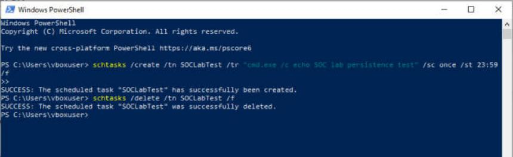
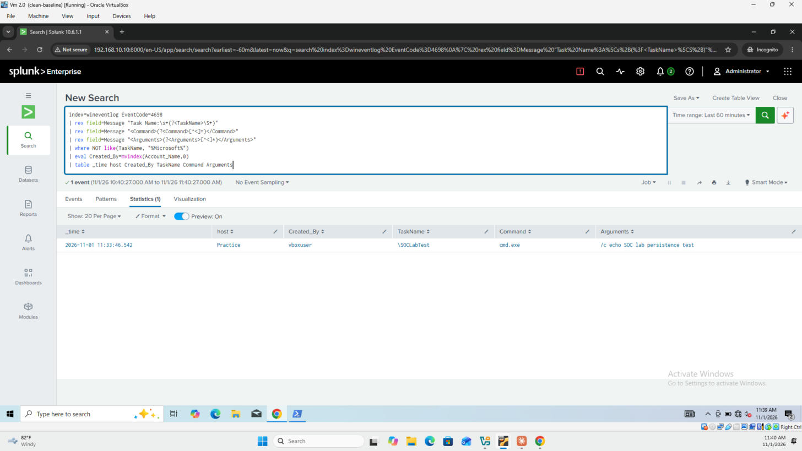
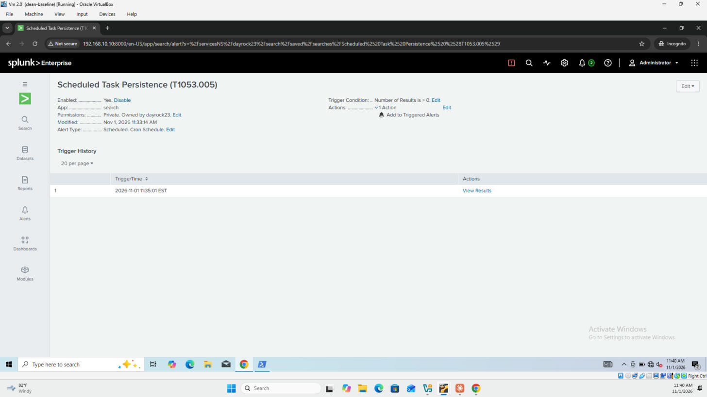

# Detection: Scheduled Task Persistence

| Field | Value |
|---|---|
| **MITRE ATT&CK** | [T1053.005 — Scheduled Task/Job: Scheduled Task](https://attack.mitre.org/techniques/T1053/005/) (Execution, Persistence, Privilege Escalation) |
| **Data source** | Windows Security log — Event ID **4698** (A scheduled task was created) |
| **Index** | `wineventlog` |
| **Severity** | High |
| **Schedule** | Every 5 minutes, searching the last 5 minutes |

---

## Description

Scheduled tasks are one of the most common ways attackers keep access to a host: a task can relaunch their malware at every logon, at startup, or on a timer, and survives reboots. Windows records every new task in Event 4698, including the full task definition as XML. This detection pulls the task name and the command it runs out of that XML, and ignores Windows' own built-in tasks.

## Detection Logic (SPL)

```spl
index=wineventlog EventCode=4698
| rex field=Message "Task Name:\s+(?<TaskName>\S+)"
| rex field=Message "<Command>(?<Command>[^<]+)</Command>"
| rex field=Message "<Arguments>(?<Arguments>[^<]*)</Arguments>"
| where NOT like(TaskName, "%Microsoft%")
| eval Created_By=mvindex(Account_Name,0)
| table _time host Created_By TaskName Command Arguments
```

**Why `rex`?** Splunk doesn't extract the task's command into its own field. The `Message` of a 4698 event contains the task definition as XML, so regular expressions pull out `<Command>` and `<Arguments>`, which are the parts an analyst needs.

**Why exclude `Microsoft`?** Windows creates and updates its own tasks under `\Microsoft\Windows\...` constantly (updates, maintenance, telemetry). Without this filter the alert would fire all day.

## Threshold

**Any result.** A new, non-Microsoft scheduled task on an endpoint is uncommon and worth reviewing.

## Testing

The alert was saved first (11:33:14), then a harmless task was created and immediately deleted:

```powershell
schtasks /create /tn SOCLabTest /tr "cmd.exe /c echo SOC lab persistence test" /sc once /st 23:59 /f
schtasks /delete /tn SOCLabTest /f
```

The task was set to run once, late at night, and only `echo`es a message. It was deleted seconds after creation (logged as Event **4699**).



**Results (2026-11-01, Splunk time):**

| Observation | Value |
|---|---|
| Alert saved | 11:33:14 |
| Task created | `\SOCLabTest` at 11:33:46 on host `Practice` |
| Created by | `vboxuser` |
| Command / Arguments | `cmd.exe` / `/c echo SOC lab persistence test` |
| Alert fired | 11:35:01, about 75 seconds after the task was created |
| Earlier finding | The search also surfaced `\TestTask` running `notepad.exe`, created by `vboxuser` on 2026-10-28 during earlier lab work |





## False Positives

- Software installers and updaters (browsers, drivers, vendor tools) creating their own tasks
- IT administrators deploying maintenance tasks
- Endpoint management tools

Tune by allow-listing known task names or vendor paths after verifying them, not by widening the `Microsoft` exclusion. Attackers sometimes name tasks to look like Microsoft ones.

## Response / Triage Steps

1. **What does it run?** Check `Command` and `Arguments`. Red flags: `powershell.exe` with `-enc` / `-WindowStyle Hidden` (see [detection 4](T1059.001-suspicious-powershell.md)), `cmd.exe /c`, `rundll32.exe`, `mshta.exe`, or files in `AppData`, `Temp` or `ProgramData`.
2. **When does it run?** Tasks triggered at logon or startup are classic persistence.
3. **Who created it?** Is `Created_By` an admin, a normal user, or `SYSTEM`?
4. **Is the task name trying to blend in?** Names like `\GoogleUpdate` or `\WindowsDefenderCheck` in the root folder are suspicious.
5. **Was it deleted quickly?** A **4698** followed soon by **4699** may mean an attacker ran something once and cleaned up.
6. If malicious: disable and export the task, collect the file it runs, and check other hosts for the same task name.

Follow-up query — task lifecycle:

```spl
index=wineventlog (EventCode=4698 OR EventCode=4699)
| rex field=Message "Task Name:\s+(?<TaskName>\S+)"
| where NOT like(TaskName, "%Microsoft%")
| eval Action=if(EventCode=4698, "Created", "Deleted")
| table _time host Action TaskName
| sort _time
```

## Improvements

- Raise severity when `Command` is a script interpreter or LOLBin (`powershell`, `cmd`, `mshta`, `rundll32`, `wscript`).
- Alert on tasks whose command points to user-writable folders (`AppData`, `Temp`).
- Also monitor **4702** (task updated): attackers may modify an existing legitimate task instead of creating a new one.
