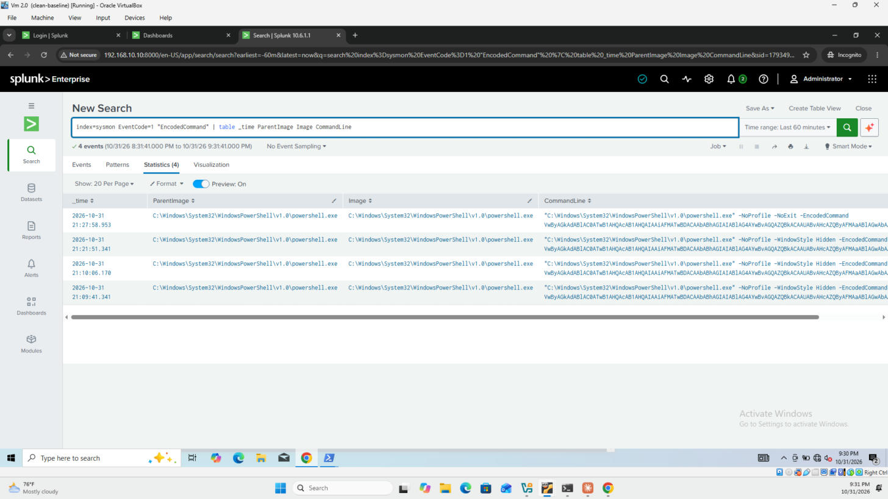
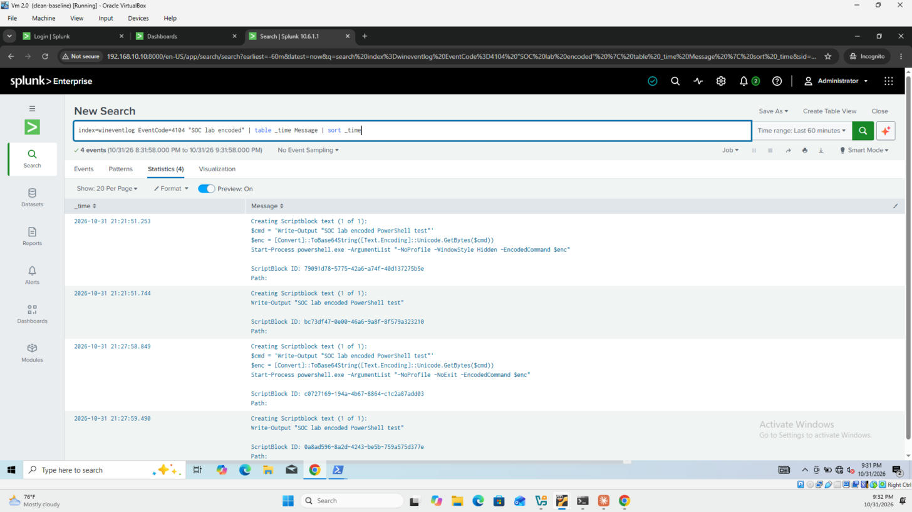
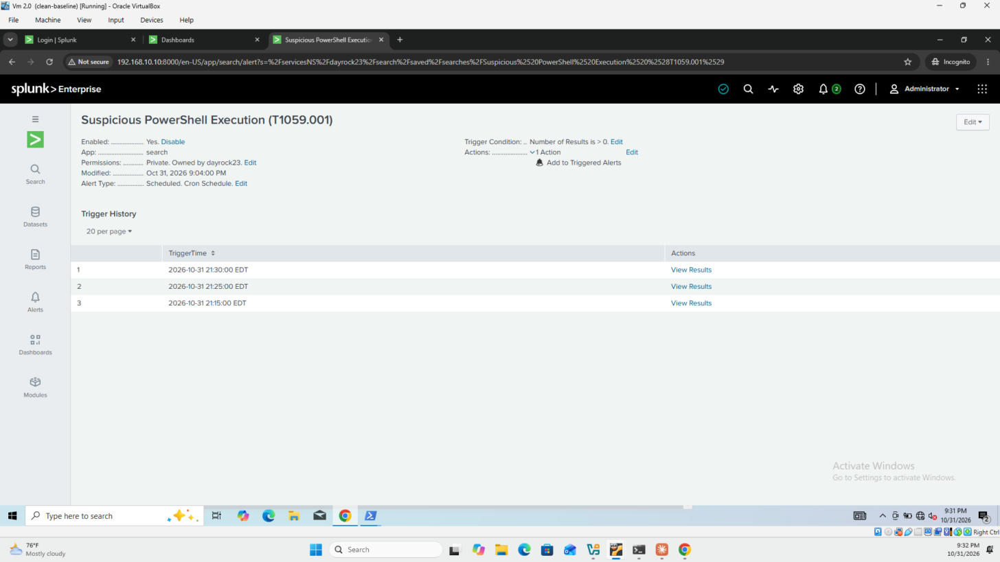

# Detection: Suspicious PowerShell Execution

| Field | Value |
|---|---|
| **MITRE ATT&CK** | [T1059.001 — Command and Scripting Interpreter: PowerShell](https://attack.mitre.org/techniques/T1059/001/) (Execution); related: [T1027 — Obfuscated Files or Information](https://attack.mitre.org/techniques/T1027/) |
| **Data sources** | Sysmon Event ID **1** (process creation); PowerShell Operational Event ID **4104** (script block logging) |
| **Indexes** | `sysmon`, `wineventlog` |
| **Severity** | High |
| **Schedule** | Every 5 minutes, searching the last 5 minutes |

---

## Description

PowerShell is built into every Windows host and is one of the most common tools attackers use after gaining access. To avoid notice they typically **Base64-encode** the command (`-EncodedCommand`), **hide the window** (`-WindowStyle Hidden`), skip restrictions (`-ExecutionPolicy Bypass`), or download and run code in memory (`IEX`, `DownloadString`). This detection looks for those flags in the PowerShell command line.

## Detection Logic (SPL)

```spl
index=sysmon EventCode=1 (Image="*\\powershell.exe" OR Image="*\\pwsh.exe")
    (CommandLine="*-enc*" OR CommandLine="*hidden*" OR CommandLine="*bypass*"
     OR CommandLine="*IEX*" OR CommandLine="*DownloadString*" OR CommandLine="*FromBase64String*")
| table _time host User ParentImage CommandLine
```

| Pattern | What it catches |
|---|---|
| `-enc` | `-EncodedCommand` / `-enc`: Base64-encoded command to hide its content |
| `hidden` | `-WindowStyle Hidden`: no visible window for the user |
| `bypass` | `-ExecutionPolicy Bypass`: ignore script execution policy |
| `IEX` | `Invoke-Expression`: run a string as code |
| `DownloadString` | Download a script from the internet (download cradle) |
| `FromBase64String` | Decode hidden content inside a script |

## Decoding What Actually Ran (Event 4104)

An encoded command line is unreadable, but **PowerShell Script Block Logging** records the script *after* it is decoded:

```spl
index=wineventlog EventCode=4104 "SOC lab encoded"
| table _time Message
| sort _time
```

In a real investigation, replace the test string with the host and time window of the alert.

## Logging Gap Found and Fixed

During testing, the encoded payload did **not** appear in Event 4104 at first. Script Block Logging was not fully enabled. Windows only auto-logs script blocks that look dangerous, and a harmless `Write-Output` doesn't qualify. The lab VM runs Windows Home (no Group Policy Editor), so logging was enabled through the registry:

```powershell
$path = "HKLM:\SOFTWARE\Policies\Microsoft\Windows\PowerShell\ScriptBlockLogging"
if (-not (Test-Path $path)) { New-Item -Path $path -Force | Out-Null }
Set-ItemProperty -Path $path -Name "EnableScriptBlockLogging" -Value 1 -Type DWord
```

After this change the decoded payload appeared in 4104 for every run. **Lesson:** without Script Block Logging, an analyst sees that an encoded command ran but not *what* it did.

## Testing

A harmless command was encoded and run the way an attacker would run a real payload:

```powershell
$cmd = 'Write-Output "SOC lab encoded PowerShell test"'
$enc = [Convert]::ToBase64String([Text.Encoding]::Unicode.GetBytes($cmd))
Start-Process powershell.exe -ArgumentList "-NoProfile -WindowStyle Hidden -EncodedCommand $enc"
```

**Results (2026-10-31, times in EDT):**

| Observation | Value |
|---|---|
| Alert saved | 21:04 |
| Test runs caught by Sysmon | 4 (21:09:41, 21:10:06, 21:21:51, 21:27:58) |
| Process chain | `powershell.exe` → `powershell.exe -EncodedCommand ...` (3 runs with `-WindowStyle Hidden`, 1 visible with `-NoExit`) |
| Decoded payload (4104) | `Write-Output "SOC lab encoded PowerShell test"` at 21:21:51 and 21:27:59, after logging was enabled |
| Alert fired | 21:15, 21:25, 21:30 |

**Sysmon: encoded command lines**


**Event 4104: the typed commands and the decoded payload**


**Alert trigger history**


## False Positives

- Administrative and deployment scripts that use `-ExecutionPolicy Bypass` or `-WindowStyle Hidden`
- Management agents (SCCM, Intune, monitoring tools) that launch encoded PowerShell
- Software installers

Tune by excluding known parent processes or signed management tools, after confirming what they run.

## Response / Triage Steps

1. **Decode the command:** check 4104 for the same host and time, or decode the Base64 from the command line (UTF-16LE).
2. **Check the parent process:** `explorer.exe` (user), `winword.exe` / `excel.exe` (malicious document), `wmiprvse.exe` (remote WMI) and `services.exe` each tell a different story.
3. **Look at what happened next:** Sysmon **3** (network connections) and **11** (files created) from the same process.
4. **Check the user:** is this account expected to run PowerShell?
5. If malicious: isolate the host, collect the decoded script as evidence, and hunt for the same command line on other hosts.

## Improvements

- Alert directly on suspicious **4104** content (e.g. `Invoke-Mimikatz`, `Net.WebClient`, `AmsiUtils`) to catch attacks that avoid suspicious command-line flags.
- Raise severity when the parent process is an Office application.
- Exclude verified management tools to reduce noise.
