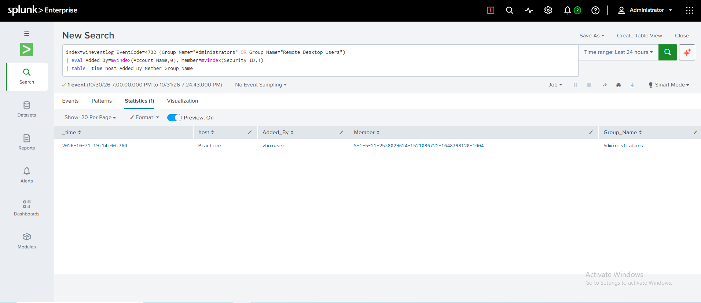
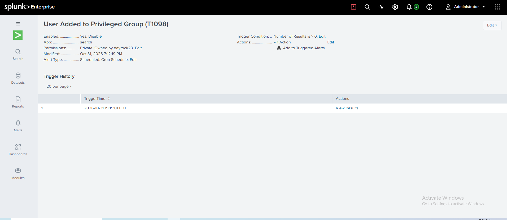

# Detection: User Added to Privileged Group

| Field | Value |
|---|---|
| **MITRE ATT&CK** | [T1098 — Account Manipulation](https://attack.mitre.org/techniques/T1098/) (Persistence, Privilege Escalation) |
| **Data source** | Windows Security log — Event ID **4732** (A member was added to a security-enabled local group) |
| **Index** | `wineventlog` |
| **Severity** | High |
| **Schedule** | Every 5 minutes, searching the last 5 minutes |

---

## Description

After creating an account ([detection 2](T1136.001-new-local-user.md)), attackers usually give it administrator rights so they have full control of the host. This detection fires when any account is added to the local **Administrators** or **Remote Desktop Users** group — the two groups that grant the most useful access to an attacker.

## Detection Logic (SPL)

```spl
index=wineventlog EventCode=4732 (Group_Name="Administrators" OR Group_Name="Remote Desktop Users")
| eval Added_By=mvindex(Account_Name,0), Member=mvindex(Security_ID,1)
| table _time host Added_By Member Group_Name
```

**Why `Security_ID` for the member?** For local accounts, Windows leaves the member's *Account Name* blank in 4732 and records only the member's **Security ID (SID)**. `mvindex(Security_ID,1)` selects the member's SID (index `0` is the account that made the change).

## Threshold

**Any result.** Changes to privileged groups are rare on an endpoint, so every one is reviewed.

## Testing

The alert was saved first, then the test was run once.

1. Created a test account: `net user testadmin <password> /add`
2. Added it to Administrators: `net localgroup Administrators testadmin /add`
3. Confirmed the 4732 event in Splunk and that the alert fired on its next scheduled run.
4. Removed the test account: `net user testadmin /delete`

**Results (2026-10-31, times in EDT):**

| Observation | Value |
|---|---|
| Alert saved | 19:12:19 |
| Account added to group | 19:14:00 on host `Practice` |
| Added by | `vboxuser` |
| Member | `S-1-5-21-2538029624-1521086722-1648398120-1004` (testadmin) |
| Group | Administrators |
| Alert fired | 19:15:01 — about one minute after the change |





## Reading the SID

The member appears as a SID rather than a name. The final number (`1004`) is the account's **RID**: values of 1000 and above are accounts created on the machine, while `500` is the built-in Administrator. To resolve a SID to a name on the host:

```powershell
Get-LocalUser | Where-Object SID -eq "S-1-5-21-2538029624-1521086722-1648398120-1004"
```

If the account has already been deleted, the name can be recovered from the matching **4720** (account created) event, which records the same SID.

## False Positives

- Administrators granting rights during legitimate setup or troubleshooting
- Software installers adding service accounts to local groups
- Group Policy or configuration-management tools enforcing group membership

## Response / Triage Steps

1. **Who made the change?** Is `Added_By` an administrator who should be doing this?
2. **Who was added?** Resolve the SID. Is it a brand-new account (check for a recent **4720**)?
3. **Which group?** Administrators means full control; Remote Desktop Users means remote access.
4. **Has the account been used?** Search for **4624** logons by it, especially Logon Type 10 (RDP).
5. If malicious: remove the account from the group, disable it, and investigate the account that made the change.

## Attack Chain

Creating `testadmin` also generates a 4720 event, which is what [detection 2](T1136.001-new-local-user.md) looks for. In a real intrusion, a **4720 followed within minutes by a 4732 for the same SID** is a strong signal of an attacker establishing a privileged backdoor account, and should be treated as higher severity than either event alone.

## Improvements

- Correlate 4720 and 4732 on the member SID to alert on "new account made admin" as a single high-severity event.
- Add more privileged groups (e.g. Backup Operators, Remote Management Users).
- In a domain, monitor domain controller events **4728** / **4756** for Domain Admins and other global/universal groups.
