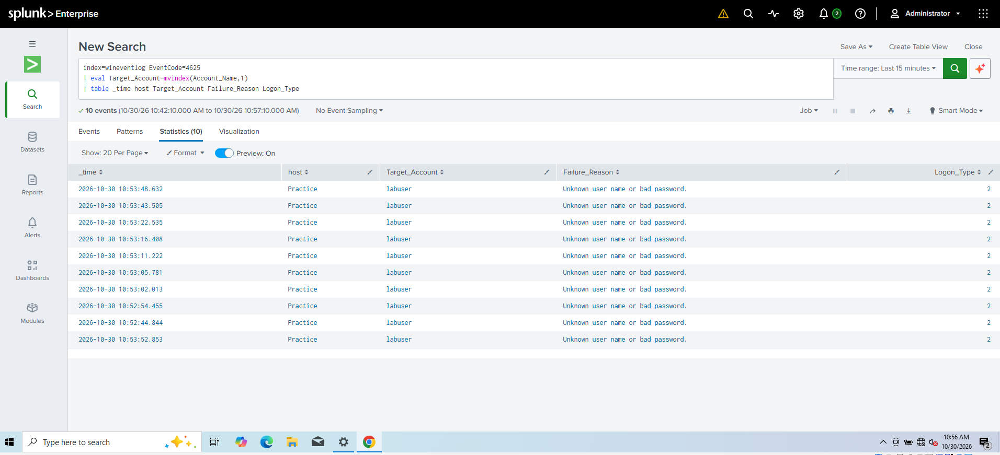
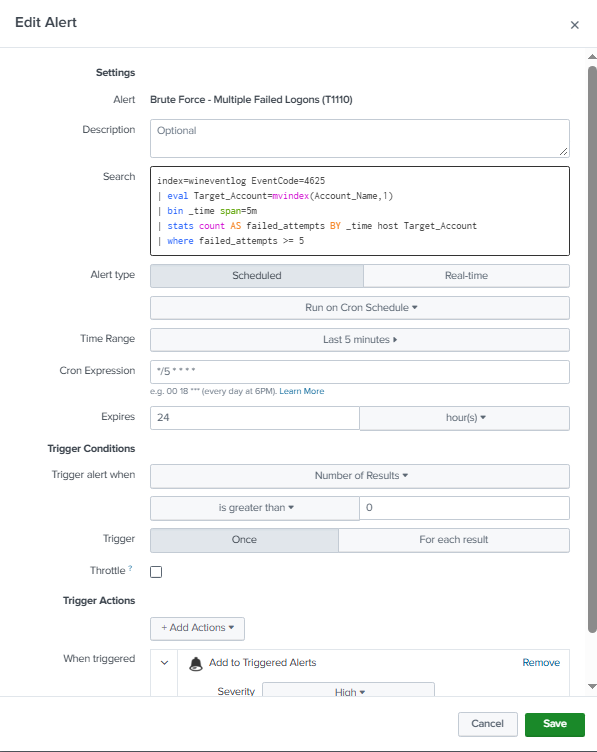
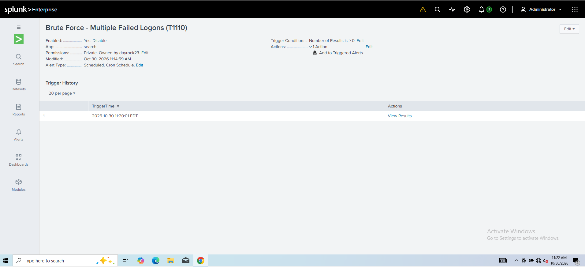

# Detection: Brute Force — Multiple Failed Logons

| Field | Value |
|---|---|
| **MITRE ATT&CK** | [T1110 — Brute Force](https://attack.mitre.org/techniques/T1110/) (Credential Access) |
| **Data source** | Windows Security log — Event ID **4625** (An account failed to log on) |
| **Index** | `wineventlog` |
| **Severity** | High |
| **Schedule** | Every 5 minutes, searching the last 5 minutes |

---

## Description

Detects repeated failed authentication attempts against the same account on a host within a short window — the core pattern of password guessing / brute-force activity.

## Detection Logic (SPL)

```spl
index=wineventlog EventCode=4625
| eval Target_Account=mvindex(Account_Name,1)
| bin _time span=5m
| stats count AS failed_attempts
        values(Logon_Type) AS logon_types
        values(Failure_Reason) AS failure_reasons
        BY _time host Target_Account
| where failed_attempts >= 5
| sort -failed_attempts
```

**Why `mvindex(Account_Name,1)`?** Event 4625 contains two `Account_Name` values: the *subject* (the process/account requesting the logon, often `-` or the machine account) and the *target* (the account being logged into). Index `1` selects the targeted account.

## Threshold

**≥ 5 failures for one account within 5 minutes.** Low enough to catch slow manual guessing in a small lab; in production this would be tuned against a baseline of normal failed-logon volume.

## Testing

1. Created a test account on the endpoint: `net user labuser <password> /add`
2. Generated ~10 failed logons with `runas /user:labuser cmd` using wrong passwords.
3. Confirmed Event ID 4625 events arrived in Splunk and the alert fired in **Activity → Triggered Alerts**.





## Useful 4625 Fields

| Field | Meaning |
|---|---|
| `Logon_Type` | 2 = interactive, 3 = network (SMB), 10 = RDP |
| `Failure_Reason` / `Sub_Status` | `0xC000006A` = bad password, `0xC0000064` = user does not exist |
| `Source_Network_Address` | Where the attempt came from (for network/RDP logons) |

A burst of `0xC0000064` (non-existent users) suggests **password spraying / username enumeration** rather than guessing a single account.

## False Positives

- Users mistyping passwords repeatedly
- Service accounts or scheduled tasks with expired / changed passwords
- Mapped drives or saved credentials retrying an old password

## Response / Triage Steps

1. Identify the source (`Source_Network_Address`, `Workstation_Name`) and logon type.
2. Check for a **4624 (successful logon)** for the same account after the failures — this indicates a possible compromise.
3. Check whether the source IP targeted multiple accounts (spraying).
4. If malicious: block the source, reset the account password, and review the account's activity.

Follow-up query — failures followed by a success:

```spl
index=wineventlog (EventCode=4625 OR EventCode=4624)
| eval Target_Account=mvindex(Account_Name,1)
| stats count(eval(EventCode=4625)) AS failures
        count(eval(EventCode=4624)) AS successes
        BY host Target_Account
| where failures >= 5 AND successes > 0
```

## Improvements

- Lower false positives by excluding known service accounts.
- Add a second rule for one source hitting **many** accounts (password spraying, T1110.003).
- Enable account lockout policy and alert on Event ID **4740** (account locked out).
