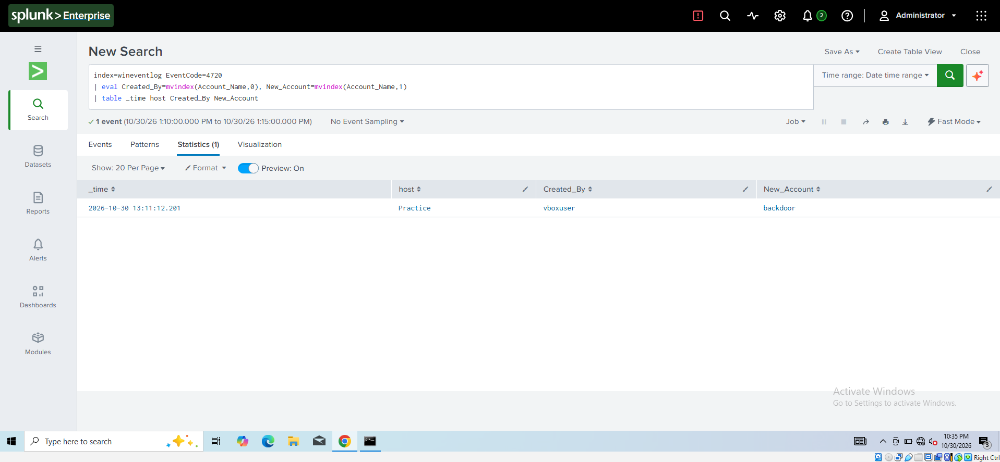
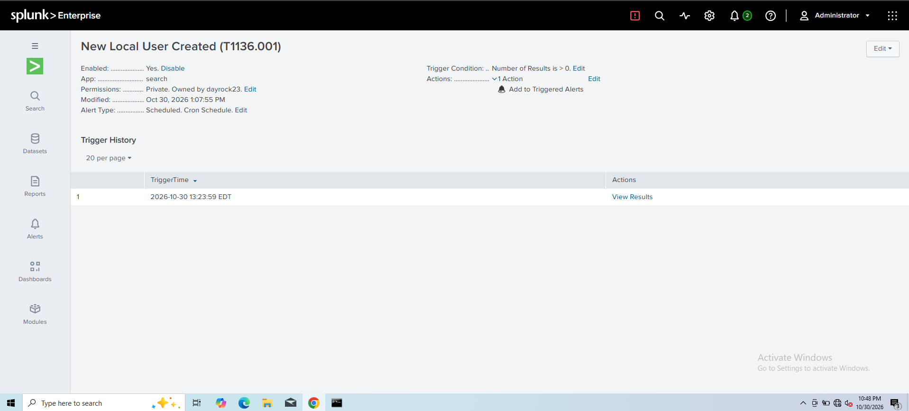

# Detection: New Local User Created

| Field | Value |
|---|---|
| **MITRE ATT&CK** | [T1136.001 — Create Account: Local Account](https://attack.mitre.org/techniques/T1136/001/) (Persistence) |
| **Data source** | Windows Security log — Event ID **4720** (A user account was created) |
| **Index** | `wineventlog` |
| **Severity** | Medium |
| **Schedule** | Every 5 minutes, searching the last 5 minutes |

---

## Description

Attackers who gain access to a host often create a new local account so they can get back in later, even if the original access is removed. Account creation is rare on a normal endpoint, so every 4720 event is worth reviewing.

## Detection Logic (SPL)

```spl
index=wineventlog EventCode=4720
| eval Created_By=mvindex(Account_Name,0), New_Account=mvindex(Account_Name,1)
| table _time host Created_By New_Account
```

**Why `mvindex`?** Event 4720 contains two `Account_Name` values: index `0` is the *subject* (who created the account) and index `1` is the *new account*. Splitting them shows both the actor and the result.

## Threshold

**Any result.** There is no count threshold; a single new account triggers the alert.

## Testing

1. Created a test account on the endpoint from an elevated prompt: `net user backdoor <password> /add`
2. Confirmed the 4720 event in Splunk with the creator and new account correctly separated.
3. Repeated the test after the alert was scheduled and confirmed the alert fired.
4. Deleted the test account: `net user backdoor /delete` (generates Event ID **4726**).

**Results (2026-10-30, times in EDT):**

| Observation | Value |
|---|---|
| Account created | `backdoor` at 13:11:12 on host `Practice` |
| Created by | `vboxuser` |
| Alert saved | 13:07:55 |
| Alert fired | 13:23:59, on a repeat run of the test |





## False Positives

- IT administrators creating accounts for new staff
- Software installers that create service accounts
- Provisioning or configuration-management tools

Tune by excluding known admin accounts in `Created_By`, or by alerting only outside business hours.

## Response / Triage Steps

1. **Who created it?** Is `Created_By` an admin who should be doing this?
2. **When?** Creation outside business hours is more suspicious.
3. **Was it given privileges?** Check for Event **4732** (added to a security group such as Administrators) right after.
4. **Has it been used?** Search for **4624** logons by the new account.
5. **Was it deleted soon after?** A 4720 followed quickly by **4726** can mean an attacker cleaning up.
6. If malicious: disable the account, investigate the creator account, and look for other persistence.

Follow-up query — account lifecycle timeline:

```spl
index=wineventlog (EventCode=4720 OR EventCode=4726 OR EventCode=4732)
| eval Action=case(EventCode=4720,"Created", EventCode=4726,"Deleted", EventCode=4732,"Added to group")
| eval Actor=mvindex(Account_Name,0), Target=mvindex(Account_Name,1)
| table _time host Action Actor Target
| sort _time
```

## Improvements

- Correlate 4720 with 4732 to raise severity when a new account is immediately made an administrator.
- Alert on short-lived accounts (4720 and 4726 for the same account within an hour).
- In a domain, monitor the domain controller for domain account creation as well.
