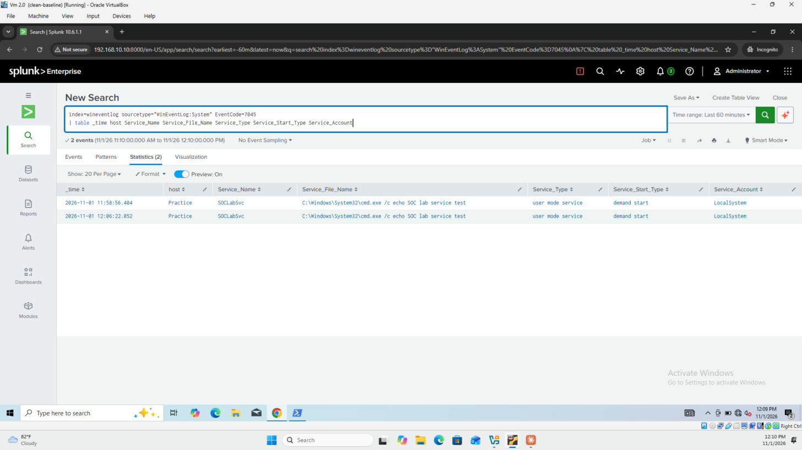
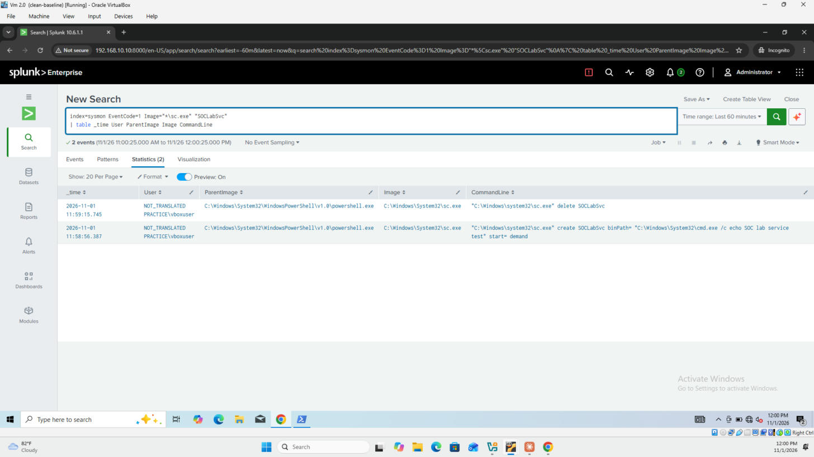
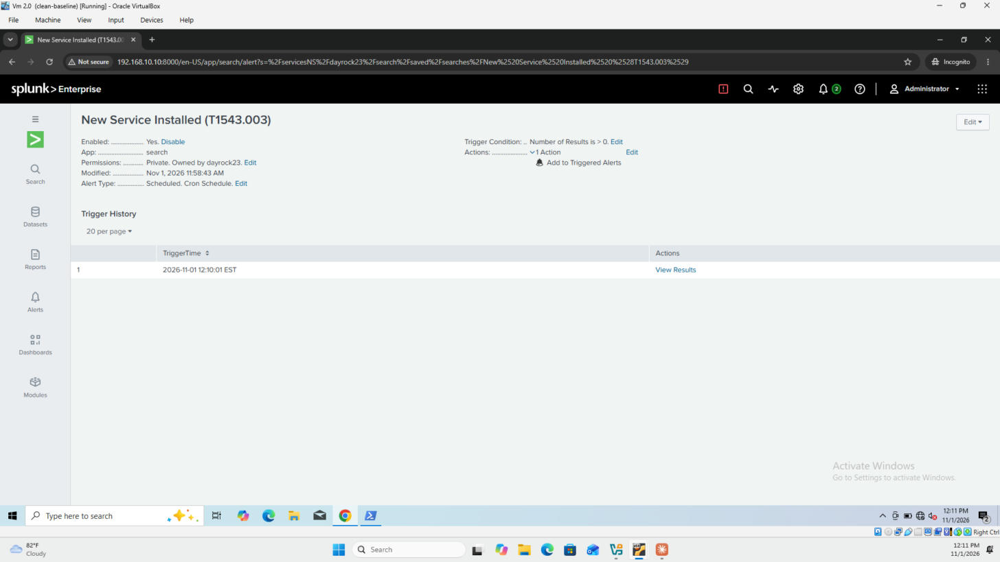

# Detection: New Service Installed

| Field | Value |
|---|---|
| **MITRE ATT&CK** | [T1543.003 — Create or Modify System Process: Windows Service](https://attack.mitre.org/techniques/T1543/003/) (Persistence, Privilege Escalation) |
| **Data sources** | Windows System log — Event ID **7045** (A service was installed); Sysmon Event ID **1** (process creation) to identify who installed it |
| **Indexes** | `wineventlog`, `sysmon` |
| **Severity** | High |
| **Schedule** | Every 5 minutes, searching the last 5 minutes |

---

## Description

Windows services start automatically, run in the background and usually run as **LocalSystem**, the most privileged account on the host. That makes them a favourite for attackers: a malicious service gives persistence across reboots and SYSTEM-level execution. Remote-execution tools such as PsExec also work by installing a temporary service, so 7045 events are a common sign of lateral movement too.

## Detection Logic (SPL)

```spl
index=wineventlog sourcetype="WinEventLog:System" EventCode=7045
| table _time host Service_Name Service_File_Name Service_Type Service_Start_Type Service_Account
```

| Field | Why it matters |
|---|---|
| `Service_File_Name` | What the service actually runs; the most important field |
| `Service_Account` | `LocalSystem` means full control of the machine |
| `Service_Start_Type` | `auto start` means it runs at every boot (persistence) |

## Who Installed It? (Sysmon)

Event 7045 records *what* was installed but **not who installed it**. Sysmon process-creation events fill that gap by showing the `sc.exe` command, the user who ran it, and its parent process:

```spl
index=sysmon EventCode=1 Image="*\\sc.exe" "SOCLabSvc"
| table _time User ParentImage Image CommandLine
```

In a real investigation, replace the service name with the one from the alert, or search Sysmon for any process started a few seconds before the 7045 event.

## Threshold

**Any result.** New services are rare on a stable endpoint outside software installs and updates.

## Testing

A harmless service was installed and immediately removed from an elevated PowerShell prompt:

```powershell
sc.exe create SOCLabSvc binPath= "C:\Windows\System32\cmd.exe /c echo SOC lab service test" start= demand
sc.exe delete SOCLabSvc
```

The service was set to **manual (demand) start** and was never started, so nothing ran. Windows logs 7045 when a service is *installed*, not when it starts.

**Results (2026-11-01, Splunk time):**

| Observation | Value |
|---|---|
| Alert saved | 11:58:43 |
| First install | 11:58:56 — `SOCLabSvc`, `cmd.exe /c echo SOC lab service test`, demand start, LocalSystem |
| Installed by (Sysmon) | `PRACTICE\vboxuser`, via `powershell.exe` → `sc.exe create ...` at 11:58:56.387 (17 ms before the 7045 event) |
| Removed | 11:59:15 (`sc.exe delete SOCLabSvc`) |
| 12:00 alert run | **Did not run.** Splunk's scheduler log showed the other five alerts ran at 12:00, but the new alert's first slot was skipped because it had been saved about a minute earlier. Its next run (12:05) only covered 12:00–12:05, so the first install was missed. |
| Second install | 12:06:22 (test repeated) |
| Alert fired | 12:10:01 |

**Lesson:** a newly saved scheduled alert may skip its first run, so events in that gap are missed. When deploying a new alert, check its first scheduled run in `index=_internal sourcetype=scheduler` before relying on it.







## False Positives

- Software installs and updates (drivers, antivirus, VPN clients, browsers)
- IT management and monitoring agents
- Windows feature installs

Tune by allow-listing verified `Service_File_Name` paths from known vendors (e.g. `C:\Program Files\<Vendor>\...`).

## Response / Triage Steps

1. **What does it run?** Red flags in `Service_File_Name`: `cmd.exe /c`, `powershell.exe`, files in `Temp`, `AppData`, `ProgramData` or `C:\Users\`, random-looking names, or `\\127.0.0.1\ADMIN$\...` paths (typical of PsExec-style tools).
2. **Who installed it?** Correlate with Sysmon 1 (`sc.exe`, `New-Service`) or a remote logon (4624 Logon Type 3) just before it.
3. **Is it set to auto start?** That means persistence across reboots.
4. **Is the name trying to blend in?** Fake names like `WindowsUpdateSvc` or random strings are suspicious.
5. **Is it still installed?** A service installed and removed within seconds is typical of remote-execution tools.
6. If malicious: stop and disable the service, collect the binary, check for a matching remote logon, and hunt for the same service name on other hosts.

## Improvements

- Raise severity when `Service_File_Name` contains a script interpreter or a user-writable path.
- Correlate 7045 with a network logon (4624 type 3) from another host in the same minute to detect PsExec-style lateral movement.
- Enable the Security audit policy for **4697** (service installed), which, unlike 7045, records the account that installed it.
